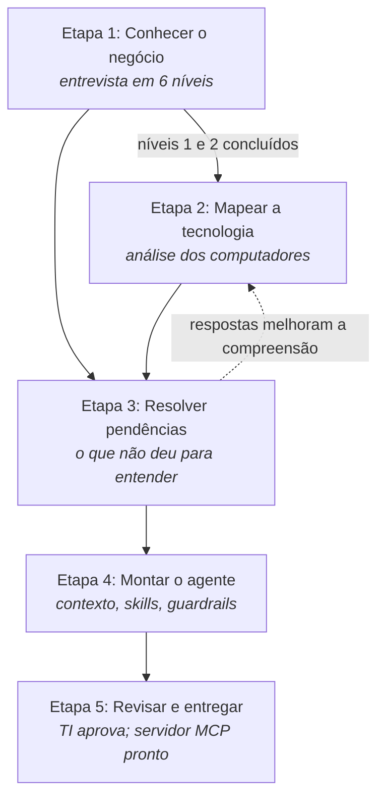

# Como funciona

Este documento explica **a lógica do processo inteiro**: o que acontece em cada etapa, por que ela vem naquela ordem e o que ela produz.

## A ideia em uma frase

Um assistente de IA só é útil se **conhece a empresa**. O MCP-Builder constrói esse conhecimento **do básico ao complexo**, confirma com pessoas tudo o que não tem certeza e entrega ao TI uma estrutura pronta para ligar o assistente.

## Os quatro princípios

| Princípio | Na prática |
|---|---|
| **Do básico ao complexo** | Primeiro o ramo de atuação, depois como a empresa funciona, e só então a tecnologia. A ferramenta **bloqueia** a análise técnica até o básico do negócio estar respondido. |
| **Perguntar em vez de supor** | O que a ferramenta não consegue entender sozinha vira uma **pendência** para uma pessoa. Uma suposição errada vira um assistente dando informação errada. |
| **Só ler, nunca alterar** | A análise dos computadores apenas consulta informações. Senhas encontradas são ocultadas antes de gravar. |
| **Uma pessoa aprova** | Nada que o assistente fará chega à operação sem aprovação humana (etapa 5). |

## O fluxo



## Etapa por etapa

### Etapa 1: Conhecer o negócio

**O que acontece:** uma entrevista em 6 níveis, do mais simples ao mais específico:

1. Identidade e ramo de atuação
2. Como a empresa atua
3. Estrutura e pessoas
4. Processos-chave e dúvidas do dia a dia
5. Sistemas e dados (do ponto de vista de quem usa)
6. O agente: objetivos e limites

**Por que vem primeiro:** um mesmo dado técnico significa coisas diferentes em empresas diferentes. Um servidor de banco de dados numa rede de restaurantes provavelmente guarda pedidos e estoque; numa clínica, prontuários. Sem o contexto do negócio, a análise técnica só produz uma lista de nomes.

**Por que nesta ordem dentro da entrevista:** cada nível usa o anterior. Não dá para perguntar sobre "processos críticos" antes de saber como a empresa ganha dinheiro, nem definir "o que o agente pode fazer" antes de conhecer os processos.

**O que produz:** `context/01-empresa.md`, o perfil da empresa que o assistente vai ler.

Detalhes: [A entrevista](03-a-entrevista.md).

### Etapa 2: Mapear a tecnologia

**O que acontece:** com autorização do responsável, a ferramenta **varre a rede** para descobrir servidores e serviços (bancos de dados, e-mail, sites internos...). Ela também **examina computadores**: programas, serviços, tarefas automáticas e conexões com bancos de dados. Tudo é comparado com um **catálogo de sistemas conhecidos** (ERPs, bancos de dados, sistemas de backup...). Nada é alterado.

**Por que depois da entrevista:** a ferramenta **cruza** o que encontrou com o que as pessoas disseram. Exemplos reais:

- A entrevista disse que o sistema A está sendo substituído pelo B, e a análise encontrou os dois → a ferramenta pergunta qual é o papel de cada um hoje.
- A análise encontrou um sistema que **ninguém citou** na entrevista → a ferramenta pergunta se ele ainda é usado, e por quem.
- A análise encontrou um indício fraco de um sistema, mas a entrevista o citou → a confiança aumenta e a pergunta fica mais direta.

**O que produz:** `inventory.json` (inventário técnico) e `context/10-hosts.md` (resumo legível).

Detalhes: [A análise técnica](04-analise-tecnica.md).

### Etapa 3: Resolver pendências

**O que acontece:** tudo o que ficou sem resposta (os `?` da entrevista e as dúvidas da análise) aparece numa lista, cada item com **por que foi perguntado** e **quem provavelmente sabe**.

**Por que existe:** nenhuma ferramenta descobre sozinha para que serve uma tarefa agendada criada há cinco anos por um técnico que já saiu. Uma pessoa da empresa responde isso em dez segundos.

**O que produz:** `questions.json`, com as respostas incorporadas ao conhecimento da empresa.

### Etapa 4: Montar o agente

**O que acontece:** **modelos de skill** transformam o que foi aprendido em:

- **Skills (habilidades):** instruções que o agente segue, como "quando chamar uma pessoa", "como abrir um chamado" ou "dúvidas sobre o sistema X"
- **Guardrails (regras de segurança):** o que o agente nunca pode fazer e quais dados nunca pode mostrar

Alguns modelos são **fixos** e valem para qualquer empresa (LGPD, senhas e golpes). Outros são **adaptáveis** e só aparecem se fizerem sentido (uma skill para cada ERP encontrado, migração de sistemas, e-mail...). O que faltar vira pendência; nada é inventado.

**Por que só agora:** o nível 6 da entrevista define os limites do agente. Sem ele, não há regras de segurança.

**O que produz:** `saida/skills/*/SKILL.md` e `saida/guardrails.md`. Tudo é gerado no seu computador, sem enviar nada para a internet.

Detalhes: [Skills](09-skills.md).

### Etapa 5: Revisar e entregar

**O que acontece:** uma pessoa do TI revisa cada skill, o perfil da empresa e cada ferramenta, e aprova ou recusa. Com o que foi aprovado, a ferramenta monta o **servidor MCP**: o programa que conecta o assistente de IA (como o Claude) ao conhecimento da empresa, aplicando as regras de segurança.

**Por que existe:** nada chega ao agente sem uma pessoa ver antes. Se algo for refeito depois, o agente continua com a versão aprovada até a próxima revisão.

**O que produz:** `saida/servidor-mcp/`, com um `LEIA-ME.md` que ensina a instalar e conectar ao Claude Desktop.

Detalhes: [Revisar, aprovar e conectar](10-servidor-mcp.md).

## E quando a empresa muda?

Basta rodar a análise de novo. A ferramenta compara com a anterior, mostra **só o que mudou**, pergunta sobre as mudanças importantes e refaz **só os arquivos afetados**. Veja [Atualização contínua](08-atualizacao-continua.md).

## O que fica na pasta da empresa

```
workspaces/restaurante-exemplo/
├── relatorio.html     ← abra no navegador: o resumo de tudo, para qualquer pessoa
├── company.json       respostas da entrevista
├── inventory.json     o que a análise técnica encontrou
├── questions.json     pendências e respostas
├── changes.json       diário de mudanças entre análises
├── generated.json     o que foi gerado e de quais informações depende
├── historico/         cópia de cada análise anterior
├── aprovacoes.json    o que o TI aprovou ou recusou
├── aprovado/          cópia exata das versões aprovadas
├── saida/             skills, regras de segurança e o servidor MCP
└── context/
    ├── 01-empresa.md  perfil da empresa (para o assistente)
    └── 10-hosts.md    computadores analisados (para o assistente)
```

Os arquivos `.json` são para a ferramenta. **Para acompanhar, use o `relatorio.html`.**
