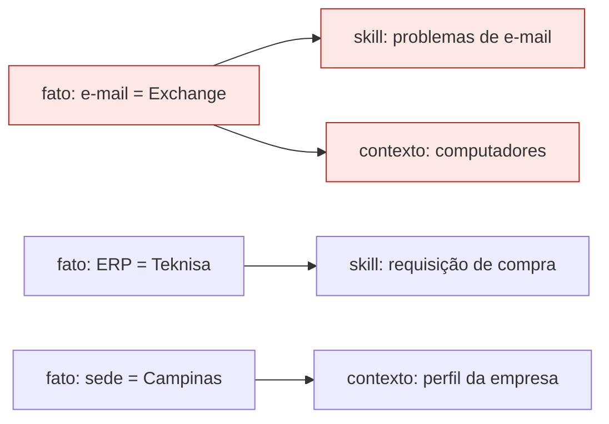

# Atualização contínua

Empresas mudam: o servidor de e-mail vai para a nuvem, um sistema é substituído, uma nova rotina de backup é criada. O assistente de IA precisa acompanhar essas mudanças, **sem refazer tudo do zero**.

## Como funciona, em uma frase

Rode a análise de novo: o MCP-Builder **compara com a anterior, mostra só o que mudou** e **refaz só o que depende dessas mudanças**.

## Na prática

No menu, a opção 3 passa a se chamar **"Atualizar a análise deste computador"** depois da primeira análise. Ao rodar, aparece algo assim:

```
✓ SRV-EMAIL analisado (servidor, Windows Server 2019)

  Mudanças desde a análise anterior (02/03/2027, 09:12):
  1 importante(s) · 2 moderada(s) · 14 de rotina
   ! Sumiu de SRV-EMAIL: sistema reconhecido Microsoft Exchange Server (certeza alta)
   - Sumiu de SRV-EMAIL: porta de rede tcp/25 (EdgeTransport)
   - Sumiu de SRV-EMAIL: programa Microsoft Exchange Server 2016

  1 nova(s) pendência(s) para confirmar com pessoas.
  Atualizado: context/10-hosts.md
  Sem alteração (não regenerado): context/01-empresa.md
```

Repare em três coisas:

1. **Só as diferenças aparecem.** As 14 mudanças de rotina (atualizações de versão, serviços do Windows) ficam registradas, mas não poluem a tela.
2. **O que é importante vira pergunta.** "O Exchange sumiu: foi desativado, levado para outra máquina ou substituído? Por qual sistema?" Assim a ferramenta não supõe nada.
3. **Só o necessário é refeito.** O perfil da empresa não mudou, então não foi regenerado.

## Os três níveis de importância

| Nível | O que é | Exemplo | O que acontece |
|---|---|---|---|
| **Importante** | Muda o que o assistente sabe ou deve fazer | Um sistema surgiu ou sumiu; uma máquina virou servidor | Registrada **e** vira pendência |
| **Moderada** | Muda como as coisas se conectam | Porta nova aberta; nova tarefa agendada; programa instalado ou removido | Registrada; tarefas e portas novas também geram pendência |
| **Rotina** | Manutenção normal | Programa atualizado de versão; serviço do Windows | Só registrada |

Respostas corrigidas na entrevista também entram no registro, sempre como **importantes**: o assistente pode estar usando a versão antiga.

## Por que só o necessário é refeito

Tudo o que a ferramenta sabe é guardado como **fatos**: pequenas informações independentes, como "a sede fica em Campinas" ou "o servidor SRV01 tem SQL Server".

Cada arquivo gerado para o assistente anota **de quais fatos depende**. Quando os fatos mudam, a ferramenta verifica quais arquivos usavam aqueles fatos e refaz **só esses**.



*Se o fato do e-mail muda, só os itens em vermelho são refeitos.*

Isso é especialmente importante quando o TI já **revisou e aprovou** parte do que foi gerado: o que não foi afetado continua aprovado.

> Hoje são acompanhados o perfil da empresa e o resumo dos computadores. As **skills** e as **regras de segurança** (próximas etapas) vão usar o mesmo mecanismo.

## Onde fica o histórico

| Arquivo | Conteúdo |
|---|---|
| `changes.json` | O **diário de mudanças**: só cresce, nada é apagado |
| `historico/<computador>/` | Uma cópia completa de cada análise anterior |
| `generated.json` | Quais arquivos foram gerados, de quais fatos dependem e em que versão estão |

O relatório (`relatorio.html`) mostra as mudanças em **"O que mudou"** e as versões em **"Arquivos gerados para o agente"**.

## Com que frequência atualizar

| Situação | Recomendação |
|---|---|
| Rotina | Uma vez por mês nos servidores |
| Depois de qualquer mudança planejada (migração, sistema novo, troca de servidor) | Logo após a mudança |
| Algo estranho aconteceu | Agora: a comparação mostra exatamente o que mudou |
