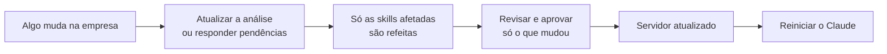

# Revisar, aprovar e conectar o agente

A **etapa 5 (Revisar e entregar)** é onde uma pessoa do TI decide o que o agente pode usar. Com o que for aprovado, o MCP-Builder monta o **servidor MCP**, o programa que conecta o agente de IA (como o Claude) ao conhecimento da empresa.

## 1. Revisar e aprovar

No menu, escolha **5. Revisar e aprovar**. Cada item aparece um por vez:

```
[6/16] Skill: Sistema Teknisa v2
  Skill adaptada. Teknisa foi identificado pela entrevista e análise técnica.
  3 informação(ões) ainda "a definir": nesses pontos o agente vai dizer que não sabe.
> v      ← mostra o conteúdo completo
> a      ← aprova
  ✓ aprovado
```

| Tecla | Faz |
|---|---|
| `a` | Aprova |
| `r` | Recusa: o item não vai para o agente |
| `v` | Mostra o conteúdo antes de decidir |
| Enter | Decide depois |
| `!sair` | Para por aqui (o que já foi decidido fica salvo) |

### O que é revisado

| Item | O que é |
|---|---|
| **Perfil da empresa** | O resumo da entrevista que o agente usa como contexto |
| **Cada skill** | O que o agente sabe fazer ([Skills](09-skills.md)) |
| **Cada ferramenta** | O que o agente pode **acionar** no servidor (veja abaixo) |

As **regras de segurança** não passam por aprovação: elas **sempre** vão para o agente. Uma regra nunca é opcional.

### A aprovação vale para uma versão

Se uma skill for refeita depois (porque alguém respondeu uma pendência ou algo mudou na empresa), o agente **continua usando a versão aprovada**. A nova versão aparece na próxima revisão como:

```
[1/1] Skill: Sistema Teknisa v3 (no ar: v2)
```

Assim nada muda no agente sem uma pessoa ver antes, e **só o que mudou** precisa ser revisado de novo.

## 2. As ferramentas do servidor

Todas são **somente leitura**: o agente consulta, mas nunca altera nada na empresa.

| Ferramenta | O que o agente pode fazer |
|---|---|
| **Buscar no conhecimento** | Procurar nas skills aprovadas e no perfil da empresa a resposta para uma dúvida |
| **Listar skills** | Ver quais skills existem e quando usar cada uma |
| **Ler uma skill** | Ler o texto completo de uma skill aprovada |
| **Regras de segurança** | Consultar as regras que nunca pode quebrar |
| **Preparar chamado** | Montar o texto de um chamado para o colaborador abrir. **Não abre o chamado sozinho.** |

## 3. As proteções do servidor

As regras não ficam só escritas nas skills: o próprio servidor as aplica.

- **Só o aprovado:** ferramentas e skills que não foram aprovadas simplesmente não existem para o agente.
- **Mascaramento:** CPF, CNPJ, números de cartão e senhas são trocados por `«oculto»` em toda resposta.
- **Aviso de senha:** se alguém digitar uma senha numa pergunta, o agente recebe o aviso para orientar a troca imediata.
- **Auditoria:** cada consulta vira uma linha em `logs/auditoria-AAAA-MM.jsonl`, com quando, qual ferramenta e os argumentos já mascarados.

## 4. Instalar e conectar ao Claude

O servidor fica em `workspaces/<empresa>/saida/servidor-mcp/`. O arquivo **`LEIA-ME.md`** dessa pasta tem o passo a passo **com o caminho exato do seu computador**. Em resumo:

1. **Instale** (uma vez): dois cliques em `instalar.bat`.
2. **Conecte:** no Claude Desktop, abra **Configurações → Desenvolvedor → Editar configuração** e cole o trecho do LEIA-ME.
3. **Reinicie** o Claude Desktop. O servidor aparece na lista de conectores.
4. **Teste** com uma pergunta das skills, por exemplo *"Como abro um chamado?"*.

Outros assistentes compatíveis com MCP usam o mesmo comando (`node servidor.js`).

## 5. Quando a empresa muda



Até a nova revisão, o agente continua com a versão aprovada anterior.

## Perguntas comuns

**Posso aprovar uma skill com informações "a definir"?**
Sim. Nesses pontos o agente vai dizer que não sabe e encaminhar para uma pessoa. Quando a informação for respondida, a skill volta para revisão já completa.

**Recusei algo por engano.**
Quando a skill for refeita, ela volta para revisão. Para rever na hora, peça a alguém técnico para apagar a linha do item em `aprovacoes.json`. Ele volta como "aguardando revisão".

**O servidor acessa o ERP ou os bancos de dados?**
Ainda não. Hoje ele entrega o **conhecimento aprovado** (skills, perfil e regras). Consultas diretas aos sistemas, sempre somente leitura e com aprovação, estão no roteiro do projeto.
