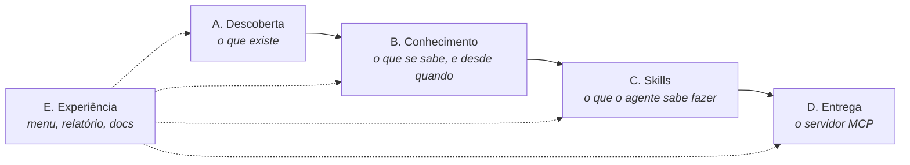

# Frentes do projeto

O MCP-Builder é organizado em **cinco frentes**. Cada uma pode evoluir separadamente, mas todas seguem os mesmos princípios: do básico ao complexo, perguntar em vez de supor, só ler e nunca alterar, e uma pessoa aprova.

| Frente | Responsável por | Situação |
|---|---|---|
| **A. Descoberta** | Entrevista, coletores (computadores, rede, bancos, e-mail, nuvem), pendências | Entrevista ✅ · computadores ✅ · rede 🔜 · bancos 🔜 |
| **B. Conhecimento** | Fatos, histórico, comparação entre análises, geração incremental | ✅ base pronta |
| **C. Skills** | Modelos que geram as skills e as regras do agente: fixos (LGPD...) e adaptáveis | ✅ 4 fixos + 5 adaptáveis · 🔜 mais modelos |
| **D. Entrega** | Servidor MCP gerado, guardrails aplicados, aprovação item a item pelo TI | 🔜 |
| **E. Experiência** | Modo guiado, atalho de dois cliques, relatório, documentação para leigos | ✅ contínua |

---

## A. Descoberta

**Pergunta que responde:** *o que existe nesta empresa?*

- Entrevista de negócio em 6 níveis ([A entrevista](03-a-entrevista.md))
- Coletores somente leitura ([A análise técnica](04-analise-tecnica.md))
- Catálogo de assinaturas de sistemas conhecidos
- Pendências para tudo o que não for interpretável

**Próximos passos:** coletor de rede (só em faixas autorizadas), coletor de estrutura de bancos de dados, detecção de serviços em nuvem (Microsoft 365, Google Workspace) pela configuração de DNS e de clientes.

## B. Conhecimento

**Pergunta que responde:** *o que se sabe, desde quando, e o que mudou?*

- **Fatos:** todo o conhecimento achatado em chaves estáveis (`src/core/facts.ts`)
- **Diário de mudanças** entre análises e respostas corrigidas (`changes.json`)
- **Histórico** de cada análise (`historico/`)
- **Manifesto:** cada arquivo gerado sabe de quais fatos depende e só é refeito quando eles mudam (`generated.json`)

Detalhes para leigos: [Atualização contínua](08-atualizacao-continua.md).

## C. Skills

Documentação para leigos: [Skills](09-skills.md). Implementação: `src/skills/`.

**Pergunta que responde:** *o que o agente deve saber fazer, e dentro de quais limites?*

Os **modelos de skill** são "skills que geram skills". Há dois tipos:

| Tipo | Como funciona | Exemplos |
|---|---|---|
| **Fixo** | Texto base pronto, válido para qualquer empresa; só os detalhes da empresa são preenchidos | LGPD e dados pessoais · segurança de senhas · quando chamar um humano · registro de tudo o que o agente consulta |
| **Adaptável** | Declara **quando se aplica** (condições sobre os fatos) e **o que lê**; nasce da interpretação do ambiente | "Requisição de compra no {ERP}" (se há ERP com compras e isso é dúvida frequente) · "Problemas de e-mail no {servidor}" · "Status de pedido no {sistema}" |

Cada modelo declara:

1. **Quando se aplica:** condições sobre os fatos. Ex.: `existe sistema da categoria "email"`.
2. **De quais fatos depende:** usado pela frente B para regenerar só o necessário.
3. **O que pergunta se faltar informação:** ex. "qual o procedimento interno para pedir uma nova caixa de e-mail?".
4. **Guardrails associados:** ex. a skill de RH herda a regra fixa "nunca mostrar salários".

Cada skill gerada registra **de quais fatos nasceu**. Se o servidor de e-mail mudar, só as skills de e-mail são refeitas, e o TI revisa só elas.

## D. Entrega *(depois das skills)*

**Pergunta que responde:** *como o agente se conecta à empresa com segurança?*

- Projeto de servidor MCP (TypeScript, SDK oficial) com tools somente leitura por padrão
- Guardrails aplicados no servidor, não só no texto: allow-list de consultas, mascaramento, log de auditoria
- Relatório de aprovação: cada tool, skill e regra precisa de um "aprovado" do TI antes de ser ativada
- Atualização incremental: uma nova versão só pede reaprovação do que mudou

## E. Experiência

**Pergunta que responde:** *uma pessoa não técnica consegue usar e entender?*

- Modo guiado com "próximo passo recomendado"
- Atalho de dois cliques
- Relatório HTML atualizado a cada passo, com o "por que" de cada pergunta
- Documentação em linguagem simples; partes geradas a partir do código para nunca ficarem desatualizadas
