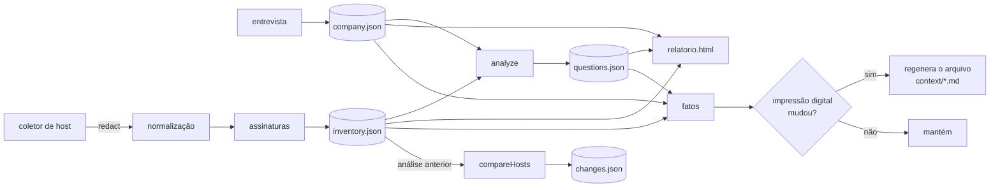

# Para desenvolvedores

Arquitetura, fluxo de dados e como estender o MCP-Builder.

## Stack

- **TypeScript / Node.js ≥ 20**, ESM
- **zod** para os esquemas dos arquivos do workspace
- **commander** para a CLI
- Sem dependências nativas: os coletores usam comandos do sistema (PowerShell/CIM no Windows; `dpkg`/`rpm`, `systemctl`, `ss`, `ip` no Linux)

```bash
npm install
npm run dev              # modo guiado, direto do código-fonte (tsx)
npm run dev -- status    # qualquer comando avançado
npm run build            # compila para dist/
npm run typecheck
npm run docs             # regenera docs/03-a-entrevista.md a partir de levels.ts
```

## Estrutura

```
src/
├── cli.ts                  entrada: sem argumentos → modo guiado; com argumentos → comandos
├── guided.ts               menu em linguagem simples
├── actions.ts              ações compartilhadas entre menu e comandos
├── generation.ts           geradores registrados + regeneração incremental (manifesto)
├── core/
│   ├── schema.ts           esquemas zod: company, inventory, questions, changes, manifest
│   ├── facts.ts            conhecimento achatado em fatos chave → valor; diff e impressão digital
│   ├── changes.ts          compara análises → mudanças classificadas + pendências
│   ├── workspace.ts        leitura e gravação do workspace (escrita atômica)
│   ├── stages.ts           as 5 etapas: fonte única para menu, status e relatório
│   ├── redact.ts           mascaramento de segredos
│   ├── prompt.ts           entrada de linhas (funciona com TTY e com pipe)
│   ├── labels.ts           rótulos em linguagem simples
│   └── ui.ts               cores do terminal
├── company/
│   ├── levels.ts           roteiro da entrevista (6 níveis)
│   ├── progress.ts         status por nível
│   ├── interview.ts        entrevista interativa e importação de respostas
│   └── context.ts          gera context/01-empresa.md
├── collectors/host/
│   ├── windows.ts          script PowerShell somente leitura
│   ├── linux.ts            coletor Linux
│   ├── index.ts            normaliza, mascara e aplica as assinaturas
│   ├── analyze.ts          cruza host × entrevista → pendências
│   └── context.ts          gera context/10-hosts.md
├── signatures/
│   ├── catalog.ts          catálogo de sistemas conhecidos
│   └── match.ts            pontuação de evidências → nível de certeza
└── report/
    └── html.ts             relatorio.html (arquivo único, sem dependências externas)
```

## Fluxo de dados



### Atualização incremental

- **Fatos** (`core/facts.ts`): chaves estáveis como `host:srv01:sistema:sqlserver` ou `empresa:erp`. Versões e sufixos aleatórios são removidos das chaves (`stableKey`) para que uma atualização de versão seja "alterado", não "removido + adicionado".
- **Reanálise** (`actions.ts → scanHostAction`): arquiva a análise anterior em `historico/`, calcula `diffFacts` e registra cada diferença em `changes.json` com importância (`alta`/`media`/`baixa`). As de importância alta viram pendência.
- **Respostas corrigidas** (`recordAnswer`): entram no diário como importância alta.
- **Geradores** (`generation.ts`): cada um declara `dependsOn` (prefixos de fatos). `refreshArtifacts` compara a impressão digital desses fatos com a do manifesto e só chama o gerador quando ela muda. Novas saídas (skills, guardrails, servidor MCP) devem ser registradas em `GENERATORS`, e não escritas diretamente.

Regras:

1. **O mascaramento acontece na coleta**, antes de qualquer gravação (`collectors/host/index.ts` chama `redactDeep`). Coletores novos devem fazer o mesmo.
2. **Coletores só leem.** Nenhum comando que altere o sistema.
3. **Na dúvida, gere uma pendência** (`ws.addQuestions`) em vez de supor. As pendências são deduplicadas por tópico e texto.
4. **Etapas técnicas respeitam a camada de negócio:** veja `MIN_LEVEL_FOR_TECH_SCAN` em `levels.ts`.
5. **Tudo o que for gerado passa por `generation.ts`**, com dependências declaradas. É isso que permite atualizar só o que mudou.

## Reconhecer um sistema novo

Acrescente uma entrada em `src/signatures/catalog.ts`:

```ts
{
  id: "meu-erp",
  name: "Meu ERP",
  category: "erp",            // erp | pdv | negocio | banco-de-dados | servidor-web | ...
  business: true,             // sistemas de negócio geram pergunta de confirmação
  software: /meu\s*erp/i,     // nome/fabricante/caminho de programa instalado
  service: /meuerp/i,         // nome/descrição/comando de serviço
  process: /^meuerp/i,        // processo escutando em porta
  ports: [9000],              // evidência fraca, só soma se houver outra pista
  config: /meuerp/i,          // DSNs ODBC e tarefas agendadas
  ambiguous: false,           // true se o nome for genérico (reduz a certeza)
}
```

Pontuação (`match.ts`): cada pista forte vale 2 e porta vale 1; ≥ 4 é alta, 2–3 média, 1 baixa.

## Acrescentar uma pergunta à entrevista

Edite `src/company/levels.ts`. Use um `id` estável (ele é a chave em `company.json`). Para perguntas condicionais, use `showIf`. Depois rode `npm run docs`.

## Acrescentar um coletor

1. Crie `src/collectors/<nome>/` com uma função que devolve dados já mascarados.
2. Estenda `InventorySchema` em `core/schema.ts`.
3. Gere pendências para o que não for interpretável.
4. Crie a ação em `actions.ts` e exponha no menu (`guided.ts`) e na CLI (`cli.ts`).
5. Atualize `core/stages.ts` (progresso da etapa 2), o relatório e `docs/04-analise-tecnica.md`.

## Roadmap

- [x] Entrevista em níveis, pendências, relatório, modo guiado
- [x] Coletor de host (Windows testado; Linux implementado, ainda sem teste em campo)
- [x] Atualização incremental: fatos, diário de mudanças, histórico, regeneração seletiva
- [ ] Modelos de skill: fixos (LGPD...) e adaptáveis, com rastreio de origem (frente C)
- [ ] Coletor de rede (somente faixas autorizadas)
- [ ] Coletor de bancos de dados (estrutura, somente leitura)
- [ ] Síntese com LLM: contexto, skills e guardrails (com remoção de dados pessoais e confirmação antes do envio)
- [ ] Geração do servidor MCP e relatório de aprovação
